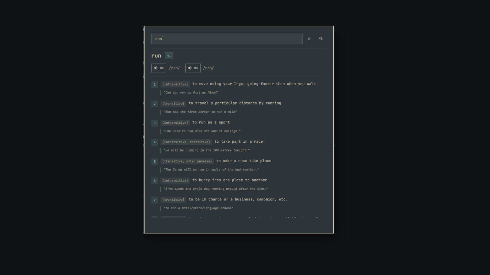
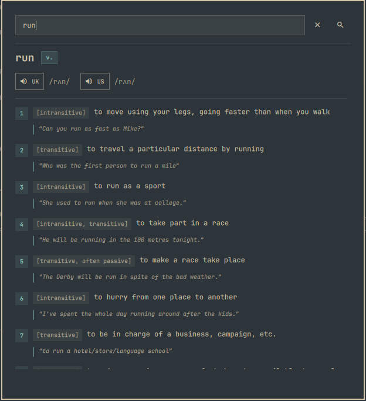
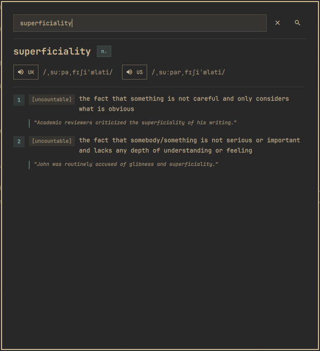

<p align="center">
  
</p>

# Oxford Learner's Dictionary (`omaxfordlearners`)

[](https://github.com/ToghrolTP/omaxfordlearners)
[](https://plugins.omarchy.org)
[](LICENSE)
[](https://www.python.org/)

An authentic, native Oxford Advanced Learner's Dictionary (OALD) desktop and bar plugin for the **Omarchy shell** (Quickshell / Hyprland).

Look up English words, grammatical forms, definitions, real-world examples, and word origins, and listen to authentic British (UK) and American (US) native pronunciations with a single click from your Omarchy bar or a global hotkey.

---

## Previews

<p align="center">
  
</p>

<table align="center">
  <tr>
    <td align="center"><b>Comprehensive Word Senses ("run")</b></td>
    <td align="center"><b>Etymology & Grammar ("superficiality")</b></td>
  </tr>
  <tr>
    <td align="center"></td>
    <td align="center"></td>
  </tr>
</table>

---

## Features

- **Authoritative Oxford Definitions**: Full definitions, grammatical classifications (e.g. `[uncountable]`, `[transitive]`, `[not usually before noun]`), and highlighted real-world usage examples.
- **Native Pronunciation Audio**: Direct, high-quality British (UK) and American (US) MP3 audio streams played seamlessly via `mpv`.
- **Phonetic IPA Transcriptions**: Clean International Phonetic Alphabet (IPA) transcriptions for both UK and US accents.
- **Word Origin & Etymology**: Historical origins and etymology cards.
- **Intelligent "Did You Mean" Suggestions**: When a word is misspelled or not found, provides interactive suggestion badges you can click to search instantly.
- **Ultra-Fast Local Caching**: Automatic persistent caching in `~/.cache/omaxfordlearners/` — repeated lookups resolve in milliseconds (~0ms latency) and are available offline.
- **Input & Clipboard Sanitization**: Built-in protection against binary data, control characters, or oversized clipboard buffers.
- **60fps Fluid & Non-Blocking**: Network requests and audio streaming run out-of-process via Quickshell's asynchronous `Process` APIs, keeping the shell UI perfectly smooth.
- **Native Omarchy Design**: Built using Omarchy Quattro tokens (`qs.Commons.Style`, `qs.Commons.Color`, `qs.Ui.KeyboardPanel`, `BorderSurface`) to automatically inherit any active Omarchy theme.
- **Desktop & CLI Friendly**: Includes full IPC support for global Hyprland keybindings, as well as a standalone CLI tool (`oxford_lookup.py`).

---

## Installation & Setup

### 1. Via Omarchy Shell Plugin Manager (Marketplace Standard)

Install and enable the plugin directly into your Omarchy bar in one command:

```bash
omarchy plugin add https://github.com/ToghrolTP/omaxfordlearners.git --enable
```

To remove at any time:
```bash
omarchy plugin remove toghroltp.omaxfordlearners
```

---

### 2. Desktop Launcher & App Menu Integration (Optional)

To also integrate Oxford Dictionary into your system application launchers (**Rofi, Walker, Fuzzel**) and install the standalone `omaxfordlearners` command into `~/.local/bin`:

```bash
# Clone and run the installer
git clone https://github.com/ToghrolTP/omaxfordlearners.git
cd omaxfordlearners
./install.sh
```

To uninstall desktop entries, binaries, and icons:
```bash
./install.sh --uninstall
```

---

## System Requirements & Security

- **Python 3** (`python3`): Pre-installed on Arch Linux / Omarchy.
- **mpv** (`mpv`): Recommended for native audio pronunciation playback. Install with your distribution's package manager (e.g. `pacman -S mpv`).
- **Quickshell & Omarchy Shell**: Standard desktop environment.

> [!NOTE]
> **No Root Privileges Required**: No `sudo` or `pkexec` permissions are required to install, run, or remove this plugin. All network requests and cached data operate strictly within standard user space (`~/.cache/omaxfordlearners/`).

---

## Accessing the Dictionary

- **Omarchy Bar Widget**: Click the book icon (**`󰏪`**) on your status bar to open the lookup popup.
- **Application Launcher**: Search for **"Oxford Dictionary"** in your launcher (Rofi / Walker / Fuzzel).
- **Hyprland Keybindings**: Add to `~/.config/hypr/hyprland.conf`:
  ```ini
  # Super + D toggles dictionary overlay
  bind = $mainMod, D, exec, omaxfordlearners

  # Super + Shift + D looks up highlighted text (clipboard selection)
  bind = $mainMod SHIFT, D, exec, omaxfordlearners --clipboard
  ```
- **Terminal CLI**:
  ```bash
  # Launch overlay with a word query
  omaxfordlearners serendipity

  # Or print raw JSON directly in your terminal
  omaxfordlearners --cli serendipity
  ```

---

## Standalone CLI Usage

The backend engine can also be used directly from your terminal:

```bash
# Standard lookup (outputs structured JSON)
./oxford_lookup.py serendipity

# Play British pronunciation audio
./oxford_lookup.py serendipity --play-uk

# Play American pronunciation audio
./oxford_lookup.py serendipity --play-us

# Bypass local cache
./oxford_lookup.py serendipity --no-cache

# Clear cached entries
./oxford_lookup.py --clear-cache
```

### JSON Structure

```json
{
  "found": true,
  "term": "serendipity",
  "pos": "noun",
  "pronunciation": {
    "uk": {
      "phonetic": "/ˌserənˈdɪpəti/",
      "audio": "https://www.oxfordlearnersdictionaries.com/media/english/uk_pron/s/ser/seren/serendipity__gb_1.mp3"
    },
    "us": {
      "phonetic": "/ˌserənˈdɪpəti/",
      "audio": "https://www.oxfordlearnersdictionaries.com/media/english/us_pron/s/ser/seren/serendipity__us_2.mp3"
    }
  },
  "senses": [
    {
      "definition": "the fact of something interesting or pleasant happening by chance",
      "examples": [
        "Meeting her like that, and there of all places, was true serendipity!"
      ],
      "grammar": "[uncountable]"
    }
  ],
  "word_origin": "1754: coined by Horace Walpole, suggested by The Three Princes of Serendip"
}
```

---

## Testing & Quality Assurance

Run the Python unit test suite:

```bash
python3 -m unittest discover tests -v
```

Validate QML syntax and imports:

```bash
qmllint -I /usr/share/omarchy/shell *.qml
```

Validate Omarchy plugin manifest:

```bash
omarchy plugin validate .
```

---

## License

MIT License. Designed and maintained by Toghrol.
