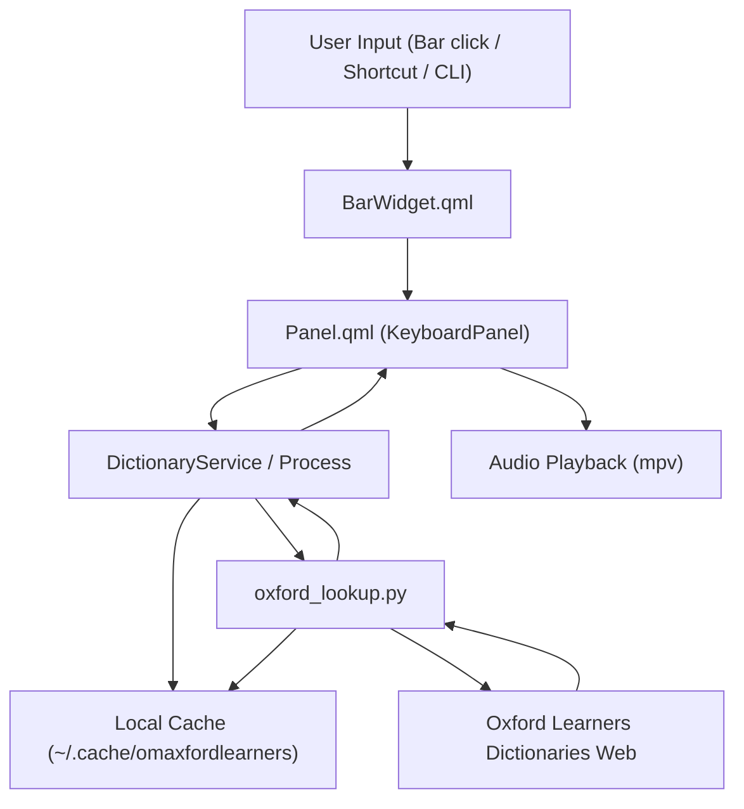

# Oxford Learner's Dictionary (`omaxfordlearners`) Design Spec

## 1. Overview & Goals

`omaxfordlearners` is a native desktop dictionary plugin for the Omarchy shell (Quickshell / Hyprland). It integrates the Oxford Advanced Learner's Dictionary (OALD) directly into the Omarchy bar and desktop environment, allowing users to look up words, view grammatical classifications, read comprehensive definitions and examples, study etymological origins, and listen to authentic British (UK) and American (US) audio pronunciations.

### Key Requirements
- **100% Native Omarchy Integration**: Full compliance with the Omarchy Quattro plugin system, utilizing `qs.Commons` (`Style`, `Color`, `Border`) and `qs.Ui` components.
- **Accurate Oxford Data Extraction**: Parse headwords, part of speech, UK/US IPA phonetic transcriptions, high-quality MP3 audio links, grammatical constraints (e.g., `[uncountable]`, `[transitive]`), senses, and example sentences matching the structure in `.developer-note/json-structure-prefrence.md`.
- **Suggestions for Unknown Words**: Extract "Did you mean" spellcheck suggestions when a word is misspelled or not found.
- **Instant Response via Caching**: Persistent JSON caching in `~/.cache/omaxfordlearners/` so repeated word searches resolve with near-zero latency.
- **Asynchronous & Non-Blocking**: UI remains fluid at 60fps; network and parsing logic run out-of-process via Quickshell's asynchronous `Process` APIs.
- **Native Pronunciation Audio**: Direct playback of UK and US audio streams using system `mpv`.
- **Keyboard Navigation & IPC**: Full keyboard navigation (Enter, Tab, Escape, arrow keys) and an `IpcHandler` surface allowing external lookup invocation via hotkey (`omarchy shell msg toghroltp.omaxfordlearners lookup <word>`).

---

## 2. Architecture & Data Flow



---

## 3. Data Schema

The JSON output from `oxford_lookup.py` directly implements the developer's preferred format:

```json
{
  "found": true,
  "term": "serendipity",
  "pos": "noun",
  "pronunciation": {
    "uk": {
      "phonetic": "/ˌserənˈdɪpəti/",
      "audio": "https://www.oxfordlearnersdictionaries.com/media/english/uk_pron/s/ser/seren/serendipity__gb_1.mp3"
    },
    "us": {
      "phonetic": "/ˌserənˈdɪpəti/",
      "audio": "https://www.oxfordlearnersdictionaries.com/media/english/us_pron/s/ser/seren/serendipity__us_2.mp3"
    }
  },
  "senses": [
    {
      "grammar": "[uncountable]",
      "definition": "the fact of something interesting or pleasant happening by chance",
      "examples": [
        "Meeting her like that, and there of all places, was true serendipity!"
      ]
    }
  ],
  "word_origin": "1754: coined by Horace Walpole, suggested by The Three Princes of Serendip..."
}
```

When a word is not found or misspelled:
```json
{
  "found": false,
  "term": "serendipiti",
  "error": "Word not found",
  "suggestions": [
    "serendipity",
    "serendipities"
  ]
}
```

---

## 4. Components & Files

1. **`oxford_lookup.py`**:
   - Python 3 backend parser. Standard library only (`urllib.request`, `re`, `html`, `json`, `pathlib`, `sys`).
   - Caches responses in `~/.cache/omaxfordlearners/`.
   - Supports CLI flags: `--no-cache`, `--play-uk`, `--play-us`, `--json`, `--clear-cache`.

2. **`manifest.json`**:
   - Omarchy plugin manifest with schema version 1.
   - Defines plugin metadata, entry points, and bar widget configuration.

3. **`BarWidget.qml`**:
   - Bar widget entry point with dictionary icon and popout coordinator hook.
   - Hosts `IpcHandler` for hotkey and shell IPC interaction.

4. **`Panel.qml`**:
   - Floating dictionary lookup popup using `KeyboardPanel`.
   - Includes search `TextField`, recent searches chips, pronunciation buttons, senses list, and origin footer.

5. **`tests/test_oxford_lookup.py`**:
   - Pytest / unittest suite verifying HTML parsing, cache mechanics, suggestions, and CLI options.

6. **`README.md`**:
   - Documentation, screenshots/preview description, hotkey configuration, and usage guide.

---

## 5. UI/UX Specifications

- **Theme Consistency**: Colors, borders, and typography derive from `qs.Commons.Color` and `qs.Commons.Style`.
- **Card Sizing**: Width capped at `Style.space(380)`, max height `Style.space(560)`.
- **Audio Buttons**: Elegant pill buttons for UK and US pronunciations with hover states and active-playing indicator.
- **Examples**: Highlighted with an indented left border using `Color.accent` at 30% opacity and italic text.
- **Suggestions**: Interactive badges; clicking any suggestion populates the search field and triggers an instant lookup.
- **Recent Searches**: Horizontal chip list of recent searches for rapid reference.

---

## 6. Error Handling & Edge Cases

- **Offline / Network Outage**: Clean user-facing error message with a "Retry" button. Cached words remain fully accessible offline.
- **Multiple Parts of Speech**: Parser captures main headword entry and associates sense-specific grammar tags.
- **Missing Audio**: Audio button gracefully disables if pronunciation URL is unavailable.
- **Empty Query**: UI prompts user to enter a word or shows recent searches.
